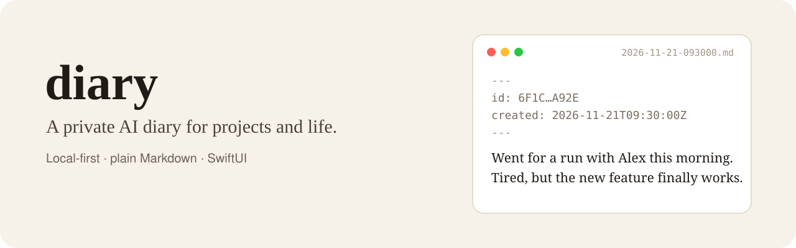
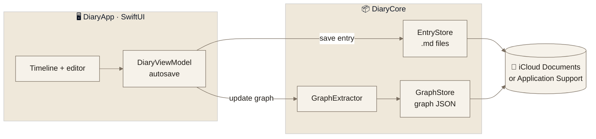

<div align="center">



# diary: write freely, let the app find the connections

**A local-first diary for projects and life. Your entries stay plain Markdown on your device; the app links the people, projects and feelings in them.**

<p align="center">
  
  
  <a href="https://github.com/astmirzhan/diary-app/actions/workflows/test.yml"></a>
</p>

<p align="center">
  
  
  
  
</p>

</div>

---

## 📓 The idea

Most journaling apps make you choose: write freely, or keep things organised with tags, links and folders.
This one keeps the writing free. You type about your day, your projects, the people around you, how you feel,
and the app works out who and what you mean, building a graph of your life in the background.

| | |
| --- | --- |
| **Plain files** | Every entry is a `.md` file with a small front matter block. Open the folder in Obsidian or any editor |
| **Private by default** | Entries live on your device (or your own iCloud). AI runs locally, or only with explicit consent |
| **No manual linking** | No `[[links]]` or tags to maintain; people and projects are recognised from the text |
| **Asks, not guesses** | Two friends with the same name? The app records the mention as unresolved and asks which one you meant |

## 🚦 Status

This is an early prototype. What works today and what is next:

| | Feature |
| --- | --- |
| ✅ | macOS SwiftUI app: timeline sidebar and a distraction-free serif editor |
| ✅ | Entries saved as Markdown with `id` and `created` front matter, autosaved while typing |
| ✅ | Storage in iCloud Documents when available, otherwise Application Support |
| ✅ | Graph model: people, projects, topics, emotions, relations between them, unresolved mentions |
| ✅ | First rule-based extractor: finds names, links people to projects mentioned in the same entry |
| 🔜 | On-device language model for entities, dates ("yesterday", "last week") and mood |
| 🔜 | One-tap prompt to resolve ambiguous names, remembered as aliases |
| 🔜 | Graph view and daily stats (mood, weight, time) |
| 🔜 | iOS app from the same code; Russian and Kazakh support |

## 🧩 How it works



An entry on disk looks like this:

```markdown
---
id: 6F1C2B7E-0D4A-4C1F-9B57-3E2D8C1FA92E
created: 2026-11-21T09:30:00Z
---

Went for a run with Alex this morning.
Tired, but the new feature finally works.
```

- **`DiaryCore`** is a plain Swift library (entries, Markdown parsing, storage, graph), so it can be shared by macOS and iOS apps and tested without UI.
- **`DiaryApp`** is a thin SwiftUI layer on top: `NavigationSplitView` with the timeline and the editor.
- **Graph entities** have a kind (`person`, `project`, `topic`, `emotion`) and aliases; a mention that matches several people becomes an `UnresolvedMention` instead of a wrong link.

## 🛠️ Run it

Requires macOS 14+ and Swift 5.9+.

```bash
swift run DiaryApp   # open the app
swift test           # DiaryCore tests
```

```
Sources/
  DiaryApp/     SwiftUI app: DiaryApp, ContentView, DiaryViewModel
  DiaryCore/    DiaryEntry, EntryStore, GraphModels, GraphExtractor, GraphStore
Tests/
  DiaryCoreTests/
```

## 🤝 Contributing

Ideas and issues are welcome. The project is small and moving fast, so open an issue before a large pull request.

<div align="center">

**diary** · MIT · your life, in plain text 📓

</div>
